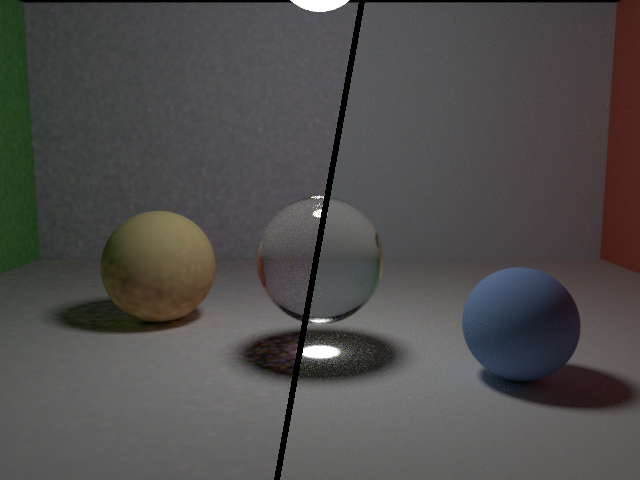
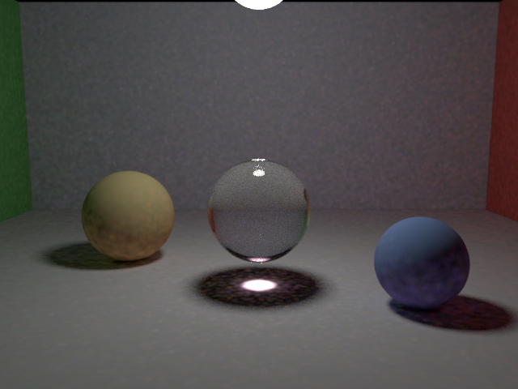
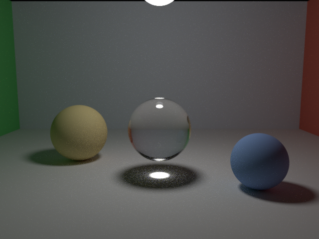

# Photon Mapping Integrator

pbrt-v4 includes a CPU `photonmap` integrator for scenes where caustics are
expensive to resolve with path tracing.  It builds a global photon map and a
separate caustic photon map before rendering camera paths.

## Usage

```pbrt
Integrator "photonmap"
    "integer maxdepth" [ 6 ]
    "integer maxphotondepth" [ 12 ]
    "integer photons" [ 1000000 ]
    "integer causticphotons" [ 500000 ]
    "float radius" [ 0.05 ]
    "float causticradius" [ 0.025 ]
    "integer maxphotons" [ 100 ]
    "bool caustics" [ true ]
```

The integrator accepts the existing `Sampler`, `Film`, `Camera`, `WorldBegin`,
and scene entity syntax unchanged.  `Integrator "photon"` is also accepted as
an alias for scenes converted from pbrt-v3.

```bash
build/pbrt examples/photonmap-caustic.pbrt
```

## Parameters

| Parameter | Default | Description |
| --- | ---: | --- |
| `maxdepth` | 5 | Maximum camera path depth. |
| `maxphotondepth` | 10 | Maximum number of photon bounces. |
| `photons` | 100000 | Number of global photon paths. |
| `globalphotons` | `photons` | Alias for `photons`. |
| `causticphotons` | 10000 | Number of caustic photon paths. |
| `radius` | 0.1 | Global photon lookup radius. |
| `maxdist` | `radius` | pbrt-v3 alias for `radius`. |
| `causticradius` | `radius` | Caustic photon lookup radius. |
| `causticmaxdist` | `causticradius` | pbrt-v3 alias for `causticradius`. |
| `maxphotons` | 50 | Nearest photons used by one estimate; 0 uses all found. |
| `caustics` | true | Enable caustic-map estimates. |
| `seed` | `--seed` | Seed for photon paths. |

Increasing `photons` and `causticphotons` reduces photon-map noise.  The
lookup radii are in scene units: too large a radius blurs detail, while too
small a radius produces sparse or black estimates.  Tune them relative to the
smallest feature size you want to resolve.

## Algorithm

1. Light paths are sampled with a power light sampler.  Surface and direction
   samples use the same `Light::SampleLe()` and BSDF conventions as the other
   pbrt-v4 CPU integrators, so existing scenes and materials work without
   conversion.
2. Photons that arrive after a diffuse interaction are inserted into the
   global map.  Photons that arrive at the first diffuse surface after one or
   more specular events are inserted into the caustic map.  Direct photons are
   not stored because camera paths sample direct illumination explicitly.
3. Photon power is normalized by the number of photon paths, accumulated with
   Russian roulette, and stored in the film color space as RGB.  Both maps use
   a uniform hash grid whose cell size equals the lookup radius.
4. At each diffuse camera-path vertex, direct illumination is sampled from the
   lights, then the global and caustic maps are queried.  The nearest
   `maxphotons` within the radius are used and the kernel radius is reduced to
   the farthest selected photon.  The path terminates at that diffuse vertex
   so diffuse transport is not counted a second time by BSDF sampling.
5. Specular and glossy camera paths continue normally, which keeps reflections
   and refractions visible while the maps provide the expensive diffuse
   transport.

The two maps partition the photon paths: caustic paths are omitted from the
global map and non-caustic paths are omitted from the caustic map.  Summing
both estimates therefore does not double count caustics.

## Example Comparison

The example scene contains a glass sphere, three diffuse spheres, colored
walls, and a spherical area light:

```bash
# Photon mapping: 128 camera samples per pixel.
build/pbrt --spp 128 --outfile images/photonmap-caustic.png \
    examples/photonmap-caustic.pbrt

# Path-tracing reference: more samples are needed for the caustic.
build/pbrt --spp 1024 --outfile images/photonmap-caustic-path.png \
    examples/path-caustic.pbrt
```

The images below use the same scene, camera, and exposure; out-of-gamut
values are clamped when the PNG comparison is written:



The diagonal split comparison shows photon mapping on the left and the
path-traced reference on the right.





The photon-map image reaches a stable caustic with a fixed photon budget,
while the path-traced comparison spends most of its effort resolving the same
caustic through a low-probability specular path.

## Limitations

- The integrator estimates surface transport.  It is intended for scenes made
  of surfaces, not scattering media; use `volpath` for participating media.
- Subsurface scattering and anisotropic hair are not represented in the
  photon maps.
- Photon flux is accumulated in the film's RGB color space, matching the RGB
  output workflow used by this integrator.  Use an RGB or gbuffer film.
- There is no progressive refinement of photon density.  Increase photon
  counts or tune the lookup radius for the desired quality.
